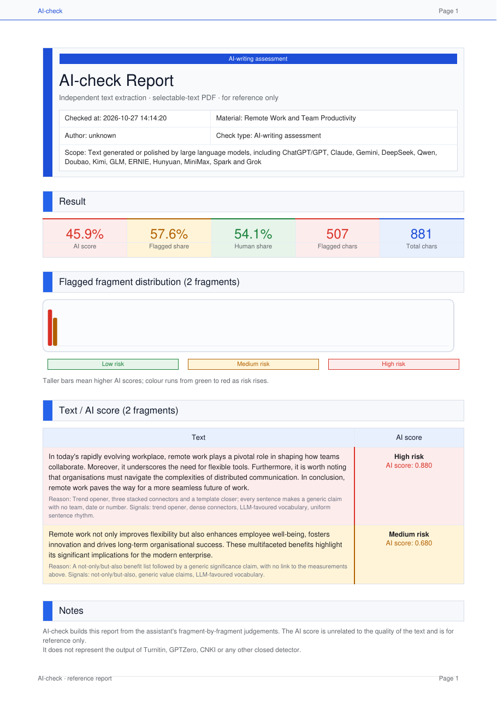

# AI-check

AI-check is an agent skill for Claude Code, Codex, OpenCode and similar assistants that gives any
material an **AI score**: an estimate of how much of it reads as written or polished by a large language
model. It works on papers, grant proposals, theses, essays, reports, emails, blog posts, web pages and
pasted text, in English or Chinese.

The assistant judges each fragment in the open, with a reason and concrete signals; bundled scripts
extract the text, collect deterministic evidence and render an HTML/PDF report. After you confirm, the
assistant can revise the flagged passages.



## Highlights

- **Any material.** Reads DOCX, PDF, LaTeX files and whole Overleaf project directories, Markdown, HTML,
  plain text, and pasted text from stdin or `--text`.
- **Fragment-level scores.** Each paragraph gets its own score, verdict and reason; short paragraphs are
  grouped with their neighbours, longer ones are judged alone.
- **Explainable signals.** Trend openers, template transitions, dense connectors, uniform sentence
  rhythm, generic value claims, LLM-favoured vocabulary ("delve", "pivotal", "underscore"), stacked
  dashes; mitigating evidence such as citations, metrics, statistics, named methods and stated
  limitations. Chinese counterparts are detected too.
- **Assistant-judged, script-assisted.** The scripts never call a model and never output a probability;
  the assistant sets every score where you can see the reasoning.
- **Report.** A selectable-text A4 PDF and an HTML page with the headline AI score, flagged share,
  fragment distribution and a table of flagged fragments with reasons.
- **Safe revisions.** For DOCX, confirmed rewrites go to a new file, optionally as Word tracked changes;
  only changed characters are touched, so formatting, superscript citations, equations, images and
  fields survive, and rewrites that drop a citation marker or a number are rejected. For other formats
  the assistant proposes sentence-level edits with locations.

## Install

Ask your assistant:

```text
Install https://github.com/lichye/ai-check-skills
```

or copy the `ai-check/` directory into your skills directory (for Claude Code: `~/.claude/skills/`).
Restart the assistant so it loads the skill.

Dependencies (Python 3.10+):

```bash
python -m pip install "python-docx>=1.1" "reportlab>=4" pypdf
```

`pypdf` is needed only for PDF input. No LibreOffice, Word automation or network access is required.

## Use

```text
Give main.tex an AI score.
Check this email draft for AI-writing style: <paste>
Score ~/papers/thesis.docx and show me the paragraphs that drive the score.
Revise the flagged paragraphs as tracked changes in a new Word file.
```

Running the scripts directly:

```bash
python ai-check/scripts/ai_check.py scan path/to/material --out scan.json
python ai-check/scripts/ai_check.py scan --text "pasted text" --title "Draft" --out scan.json
# the assistant writes results.json with one aiScore per chunk
python ai-check/scripts/ai_check.py report scan.json results.json --out-dir reports/
```

`examples/remote-work.md` with `tests/fixtures/sample_results.json` reproduces the preview above.

## Layout

```text
ai-check/
  SKILL.md                    skill instructions
  agents/openai.yaml          Codex agent metadata
  scripts/
    ai_check.py               scan (text extraction + signals) and report (HTML/PDF)
    ai_rewrite_docx.py        confirmed DOCX rewrites, optionally as tracked changes
  references/
    ai_score_signals.md       risk and mitigating signal vocabulary
    report_format.md          report contract
docs/assets/                  README preview
examples/                     sample material
tests/                        pytest suite and fixtures
```

## Tests

```bash
python -m pip install pytest
python -m pytest tests
```

## Notes

- The AI score is a reference judgement. It does not represent Turnitin, GPTZero, CNKI or any other
  closed detector, and it says nothing about the quality or correctness of the text.
- Revisions keep facts, terminology, formulas, numbers, citation markers and the direction of every
  conclusion. When the source lacks evidence, the assistant adds scope or limitation language; it never
  invents experiments, data, cases or citations.

## Credits and license

Forked from [HoneyMeta/ai-check-skills](https://github.com/HoneyMeta/ai-check-skills), which provides
the DOCX pipeline, signal scanner, report renderer and tracked-change rewriter. This fork adds LaTeX,
Markdown, HTML, PDF and pasted-text input, paragraph-level scoring and an English, general-purpose
skill and report.

MIT License; see [LICENSE](LICENSE).
